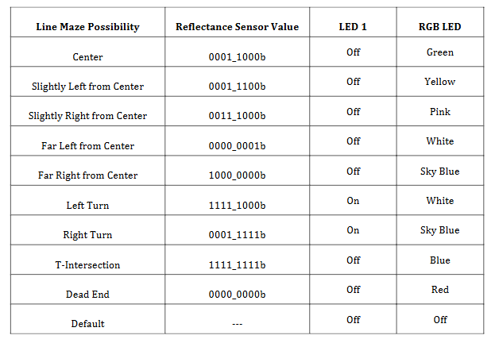
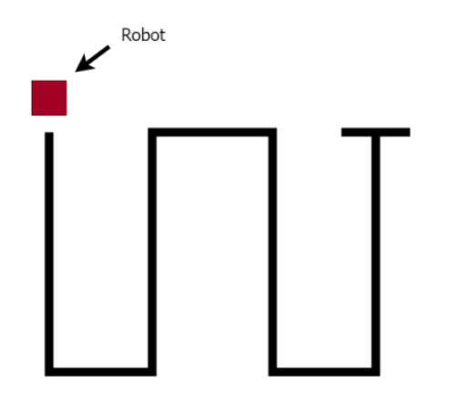

# ECE 528/L - Robotics and Embedded Systems with Lab
**CSU Northridge**

**Department of Electrical and Computer Engineering**

## Line Follower Lab

### Overview:

This lab builds on the functions developed in Lab 2 for the reflectance sensors and aims to show how "the 8-Channel QTRX Sensor Array module can be used to create a Line Follower robot that will drive along a line maze course." The robot must follow the line out to a T-intersection, turn around, and return to stop at the dead end at the starting point. This was done by setting up a state machine that runs on an interrupt executing every 1 ms and reads the reflectance sensors every 10 ms, with the main loop left empty. Ultimately, in this lab we were able to make a successful line following robot, with a few limitations that are called out later in this report.

### Components Used:
This Line Follower lab interfaces with the following:

* User LEDs of the TI MSP432 LaunchPad
* Pololu Gearmotor with Encoder - [Product Link](https://www.pololu.com/product/3675)
* 8-Channel QTRX Sensor Array - [Product Link](https://www.pololu.com/product/3672)

### Analysis and Results: 

#### Pre-Lab 
---
This lab has the following pre-lab assignments that we were asked to answer. See below for each question along with its response:


***1. Write a void function named Chassis_Board_LEDs_Init that takes no arguments and initializes the following pins as output GPIO pins. Initialize the value of the pins to zero.***
* ***P8.0 (Front Left Yellow LED)***
* ***P8.5 (Front Right Yellow LED)***
* ***P8.6 (Back Left Red LED)***
* ***P8.7 (Back Right Red LED)***


```c

void Chassis_Board_LEDs_Init()
{
    P8->SEL0 &= ~0xE1;
    P8->SEL1 &= ~0xE1;
    P8->DIR  |= 0xE1;

    P8->OUT  &= ~0xE1;

}

```


***2. Write a void function named Print_Tenth that takes no arguments. Your function must iterate from 10 to 51 using a for-loop. Print a message for every 10th iteration (10, 20, 30, 40, 50) that states “Index %d: Every 10th iteration.\n” and then print a different message for the iterations that follow after the 10th iteration (11, 21, 31,41, 51) that states “Index %d: Following the 10th iteration.\n.” Use the following starter code for your main program. Save the main program as print_tenth.c in your assignment repository.***


```c

#include <stdio.h>
void Print_Tenth();


int main()
{
Print_Tenth();
return 0;
}


void Print_Tenth()
{

int start_count = 10; 
int end_count = 51; 

for(int i = start_count; i<51 ; i++){
    
    if(i % start_count == 0) 
    {
    printf("Index %d: Every 10th iteration.\n",i);
    } 
    
    else if(i % start_count == 1)
    {
    printf("Index %d: Following the 10th iteration.\n",i);  
    }
    
    else
    {
    printf("NA \n");    
    }
    
    }
}


```

---
#### Lab Tasks

This lab builds on the functions developed in Lab 2 by implementing them in a `main.c` function. The following tasks are broken up by what needed to be implemented. 

***Include Statements***

First, we needed to set up the `main.c` function with the following include statements:

```c
// Initialzation of Headers
#include "msp.h"
#include "inc/Clock.h"
#include "inc/CortexM.h"
#include "inc/GPIO.h"
#include "inc/EUSCI_A0_UART.h"
#include "inc/Motor.h"
#include "inc/Timer_A1_Interrupt.h"
#include "inc/SysTick_Interrupt.h"
#include "inc/Reflectance_Sensor.h"
```

***Detect_Line_Position Function Setup***

Additionally, we were asked to implement an `enum` so that we can use it to keep track of the robot’s position as it goes through the line maze.

```c
// Definitions for Reflectance Sensor State
typedef enum
{
    CENTER                 = 0b00011000,
    SLIGHT_LEFT_CENTER     = 0b00011100,
    SLIGHT_RIGHT_CENTER    = 0b00111000,
    FAR_LEFT               = 0b00000001,
    FAR_RIGHT              = 0b10000000,
    LEFT_TURN              = 0b11111000,
    RIGHT_TURN             = 0b00011111,
    T_INTERSECTION         = 0b11111111,
    DEAD_END               = 0b00000000
} Line_Position;
```

***Timer_A1 Interrupt Periodic Task Function Setup***

We then implemented this Timer_A1 interrupt to execute every 1 ms, which will be used for checking the robot's line position and will serve as our "clock" for our logic. The interrupt will check for 10 milliseconds to have passed before calling our reflectance sensors to start recording. At 11 ms, it will stop recording and mark the last value as the recorded state for the iteration, and this value is what will be passed down to later sections of the code. This is then repeated for every 10ms.  

```c
void Timer_A1_Periodic_Task(void)
{

Timer_A1_ms_elapsed++;

    if ((Timer_A1_ms_elapsed % 10) == 0)
    {
     Reflectance_Sensor_Start();
    }

    if((Timer_A1_ms_elapsed % 10) == 1)
    {
        uint8_t Reflectance_Sensor_Data = Reflectance_Sensor_End();
        Detect_Line_Position(Reflectance_Sensor_Data);
        Controller(Reflectance_Sensor_Data); // <-- added later by DSR 
    }

}
```


***Main() Setup***

The last thing needed for setting up the foundation for this lab is to call the initialization functions in `main()`, as well as verify that the code is functioning the same as in Lab 2 by verifying the outputs using the table provided below. With this code verified, we will then be set up to begin the main task of this lab: creating the Line Following Logic. 

```c
int main(void)
{

    DisableInterrupts();
    Clock_Init48MHz();
    LED1_Init();
    LED2_Init();
    EUSCI_A0_UART_Init_Printf();
    Reflectance_Sensor_Init();
    SysTick_Interrupt_Init(SYSTICK_INT_NUM_CLK_CYCLES,SYSTICK_INT_PRIORITY);
    Timer_A1_Interrupt_Init(&Timer_A1_Periodic_Task,TIMER_A1_INT_CCR0_VALUE);
    Motor_Init();
    EnableInterrupts();


    while(1)
    {

    }
}
```




---
#### Line Following Task 
This lab tasks us with developing a controller that uses the previously developed line detection functions, following the given design criteria. 

***Design Criteria***
* Your Line Follower robot should fully explore the line maze provided by the
instructor. It should always move forward if it is at the center of the black
line. An example line maze is shown in the following diagram.
* After the robot has explored the T-intersection, it should go back to the
starting point and reach the dead end.
* Your solution must use periodic tasks. The main while loop must be empty.
* Use global flags or variables in your main program if necessary.
* Include code documentation for all the functions that you’ve either updated
or implemented
* Example Course: 




***Design Implementation***

The initial idea was to hard code the motor control into the `Detect_Line_Position` function, but this led to needing to fine-tune multiple parameters and to instances where the robot would potentially be driving blind. Therefore, after looking back at section 4.6 of Lab 3 and discussing with a few peers, the decision was made to use two additional functions to help with the line following logic. These functions are `LineFollowing`, which will handle the motor control and steering based on what it is given, and `Controller`, which takes the same readings used in `Detect_Line_Position` and decides what state the robot is in. In doing so, we created a state machine where what the robot sees, what it decides to do, and how it executes that decision are three separate functions. A summary of this is shown below: 

***Functions Summary:***

`Detect_Line_Position`: reports what the sensors see (LEDs).

`LineFollowing`: steers based on the reading.

`Controller`: makes decisions (T, turnaround, end of line).

***Detect_Line_Position Function***

The `Detect_Line_Position` function is the same as in Lab 2, minus the print statements, and now returns the sensor data as an output. Therefore, there is minimal need for additional explanation. It simply takes the sensor readings and, based on the bitmask, assigns the appropriate LEDs corresponding to line position state the robot is seeing and returns the unchanged sensor reading. 

```c
uint8_t Detect_Line_Position(uint8_t reflectance_sensor_data){

    switch(reflectance_sensor_data){

        case CENTER:
        LED1_Output(RED_LED_OFF);
        LED2_Output(RGB_LED_GREEN);
        break;

        case SLIGHT_LEFT_CENTER:
        LED1_Output(RED_LED_OFF);
        LED2_Output(RGB_LED_YELLOW);
        break;

        case SLIGHT_RIGHT_CENTER:
        LED1_Output(RED_LED_OFF);
        LED2_Output(RGB_LED_PINK);
        break;

        case FAR_LEFT:
        LED1_Output(RED_LED_OFF);
        LED2_Output(RGB_LED_WHITE);
        break;

        case FAR_RIGHT:
        LED1_Output(RED_LED_OFF);
        LED2_Output(RGB_LED_SKY_BLUE);
        break;

        case LEFT_TURN:
        LED1_Output(RED_LED_ON);
        LED2_Output(RGB_LED_WHITE);
        break;

        case RIGHT_TURN:
        LED1_Output(RED_LED_ON);
        LED2_Output(RGB_LED_SKY_BLUE);
        break;

        case T_INTERSECTION:
        LED1_Output(RED_LED_ON);
        LED2_Output(RGB_LED_BLUE);
        break;

        case DEAD_END:
        LED1_Output(RED_LED_ON);
        LED2_Output(RGB_LED_RED);
        break;

        default:
        LED1_Output(RED_LED_OFF);
        LED2_Output(RGB_LED_OFF);
        break;

    }

   return reflectance_sensor_data;
}

```


***LineFollowing Function***

The `LineFollowing` function takes the same sensor data that was seen in `Detect_Line_Position`, but in this case determines the appropriate motor control that should be given to the robot. During development, it was found that there were a few more cases that `Detect_Line_Position` was not detecting, which caused the logic to fall through to the default case and hold the last know motor command leading to issues. So the additional cases were added here so the robot would more closely follow the line without getting so far astray that it would get off the path completely. 


```c
void LineFollowing(uint8_t reflectance_sensor_data){

    update_Counters(reflectance_sensor_data);

    switch(reflectance_sensor_data){

    case CENTER:
        Motor_Forward(FWD_DUTY, FWD_DUTY);
        break;

    case SLIGHT_LEFT_CENTER:
        Motor_Forward(FWD_DUTY, STEER_GENTLE);
        break;

    case SLIGHT_RIGHT_CENTER:
        Motor_Forward(STEER_GENTLE, FWD_DUTY);
        break;

    case FAR_LEFT:
    case 0x03:
        Motor_Right(PIVOT_DUTY, PIVOT_DUTY);
        break;

    case FAR_RIGHT:
    case 0xC0:
        Motor_Left(PIVOT_DUTY, PIVOT_DUTY);
        break;

    case RIGHT_TURN:
    case 0x06:
    case 0x07:
    case 0x0C:
        Motor_Forward(FWD_DUTY, STEER_HARD);
        break;

    case LEFT_TURN:
    case 0x60:
    case 0xE0:
    case 0x30:
        Motor_Forward(STEER_HARD, FWD_DUTY);
        break;

    case DEAD_END:
    case T_INTERSECTION:
    default:
        break;

    }

}
```


***Controller Function***

The `Controller` function is the top-level decision maker for the robot; it determines what state the robot is actually in. We came up with 4 states: "Following Path", "Finding Path", "Returning", and "Stopped", each with its dedicated purpose, summarized below.

The `Following_Path` state is the normal line following state, where the robot is driving out on its initial pass, and it won't completely stop even if it sees the dead end condition. This continues until it detects a T-intersection, including if the robot goes off the path. This is a potential limitation, but it was deliberately done after multiple attempts led to the robot ending the run too early.

The `Finding_Path` state is normally used to find the path after a T-intersection is detected. It does this by spinning in place at the T until the center sensors see the line again. Another limitation of this state is that once it is entered, the only way to exit is through the `Returning` state. This means that if by chance we enter this `Finding_Path` state by accident and the robot somehow gets off course, there is still a chance for the run to end early, so the issue was mitigated but not completely gone. 

The `Returning` state functions the same as the `Following_Path` state, with the only change being that if a dead end condition `0x00` is seen, the robot will enter the `Stopped` state and stop the motors entirely. 


The `Stopped` state is the final state, where the robot stops the motors completely, and even a new reading will not allow the robot to enter a new state. The only thing that will bring it out of this state is a power cycle/reset of the robot. 

These states and their implementation can be seen in the function below. 

```c

void Controller(uint8_t reflectance_sensor_data)
{

    switch (Current_Robot_State)
    {
        case FOLLOWING_PATH:

            if(t_count >= T_SEC_REAL)
            {
                t_count = 0 ;
                DeadEnd_count = 0;
                Motor_Right(PIVOT_DUTY, PIVOT_DUTY);
                Current_Robot_State = FINDING_PATH;
            }

            else
            {
                LineFollowing(reflectance_sensor_data);
            }

            break;


        case FINDING_PATH:

            if (reflectance_sensor_data == CENTER)
            {
                t_count = 0 ;
                DeadEnd_count = 0;
                Motor_Forward(FWD_DUTY, FWD_DUTY);      
                Current_Robot_State = RETURNING;
            }

            else
            {
                Motor_Right(PIVOT_DUTY, PIVOT_DUTY);  
            }
            break;


        case RETURNING:

            if(DeadEnd_count >= DEAD_END_REAL)
            {
                t_count = 0 ;
                DeadEnd_count = 0;
                Motor_Stop();
                Current_Robot_State = STOPPED;
            }

            else
            {
                LineFollowing(reflectance_sensor_data);
            }

            break;


        case STOPPED:
        default:
            Motor_Stop();
            Current_Robot_State = STOPPED;
            break;
    }
}

```


***Logic Counters Helper Function***

During initial testing, and as you can see in the previously displayed functions/code blocks, we have these additional variables called counters that are used to ensure no spontaneous readings of T-intersection and/or dead end conditions cause the robot to end the run prematurely. That's why we have these constants and global variables called `T_SEC_REAL`, `DEAD_END_REAL`, `t_count`, and `DeadEnd_count`. The constants labled as real are the threshold values that are fine-tuned for the logic and are used to compare against the count variables. These count variables track how many sensor readings in a row have matched the T-intersection pattern `0xFF` and the dead-end pattern `0x00`.

```c 
void update_Counters(uint8_t reflectance_sensor_data)
{
    if (reflectance_sensor_data == T_INTERSECTION)
    {
        t_count = t_count + 1;
    }
    else
    {
        t_count = 0;
    }

    if (reflectance_sensor_data == DEAD_END)
    {
        DeadEnd_count = DeadEnd_count + 1;
    }
    else
    {
        DeadEnd_count = 0;
    }
}

```


#### Results

With these functions implemented and the parameters fine-tuned, we were able to get the robot to successfully complete a line following course. The following video diaplays that run and can also be found in the results folder of this repo.

Link to Successful Run: 

https://drive.google.com/file/d/1L1a1ckwoUCI35kEG2TTy30uqGOnVh2c0/view?usp=sharing


### Known Issues or Limitations: 

A known limitation/quirk is that the robot, on the initial drive out, will not completely come to a dead stop, since the motors only truly stop when entering the stopped state, which is only entered from the return state. 

Another limitation of the `Finding_Path` state is that once it is entered, the only way to exit is through the `Returning` state. This means that if by chance we enter this `Finding_Path` state by accident and the robot somehow gets off course, there is still a chance for the run to end early.

Lastly, slightly less important but still worth mentioning: on the 90 degree turns, or quick consecutive changes and/or small adjustments, the movement of the robot is jerky/abrupt and sudden.


### Author Contributions:
Jamal B. helped with consulting and answering questions that came up during lab time. Code generated individually.


### References:

1. MSP432P401R SimpleLink Microcontroller LaunchPad Development Kit User's Guide - [Link](https://docs.rs-online.com/3934/A700000006811369.pdf)

1. MSP432P401R Datasheet - [Link](https://www.ti.com/lit/ds/slas826e/slas826e.pdf)

1. MSP432P4xx SimpleLink Microcontrollers Technical Reference Manual - [Link](https://web.archive.org/web/20200402132841/http:/www.ti.com/lit/ug/slau356i/slau356i.pdf)